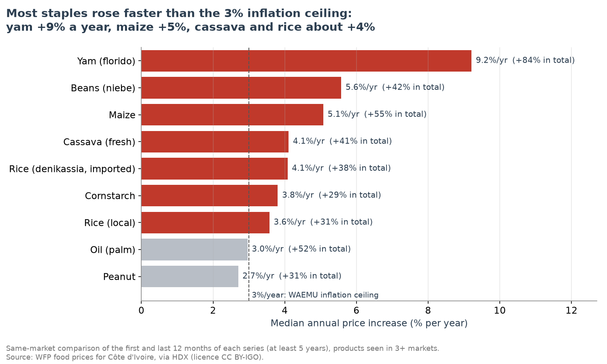
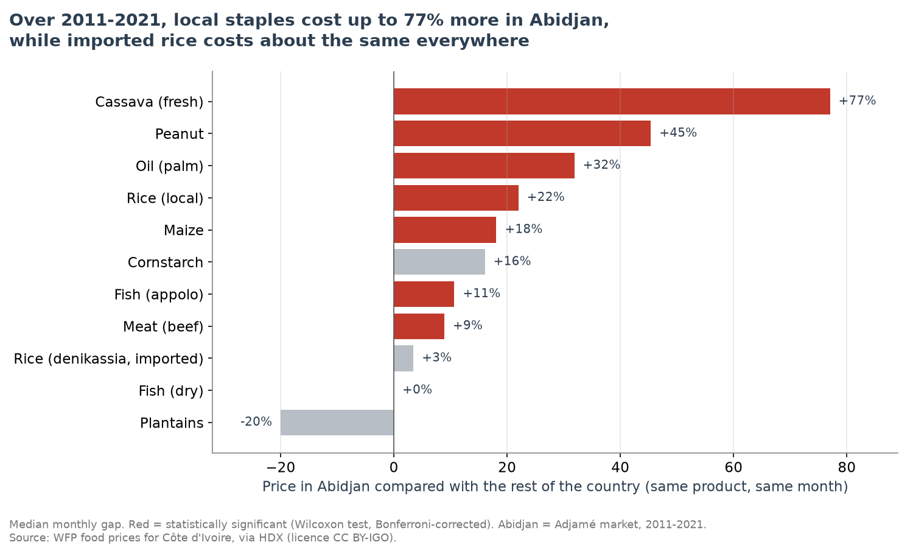
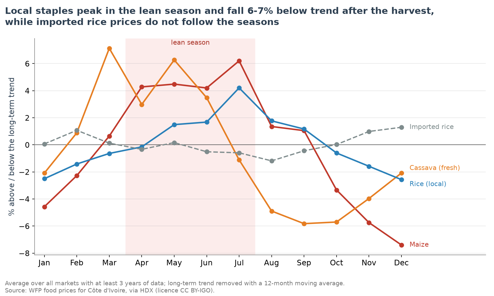

# Food prices in Côte d'Ivoire (food-price-ci)

How have staple food prices evolved in Côte d'Ivoire since 2005, where are they highest, when do they peak, and can sudden price shocks be detected automatically?

## 1. Problem

Rice, maize, cassava and yam make up a large share of household spending in Côte d'Ivoire, so their prices matter for food security. This project analyses 20 years of market prices collected by the World Food Programme (WFP) to answer four questions:

1. Which staples had the largest price increase over the period?
2. Do prices differ significantly between Abidjan and the other regions?
3. Is there seasonality (rice, maize, cassava...)?
4. Can price shocks be detected automatically?

## 2. Data

- **Source:** [WFP - Côte d'Ivoire Food Prices](https://data.humdata.org/dataset/wfp-food-prices-for-cote-d-ivoire), published on the Humanitarian Data Exchange (HDX).
- **Licence:** [CC BY-IGO 3.0](http://creativecommons.org/licenses/by/3.0/igo/legalcode). Data © World Food Programme, reused with credit.
- **Snapshot used:** downloaded on 4 November 2026. It contains 10,992 monthly retail prices, January 2005 to September 2026, 17 markets, 27 products.
- The raw file is **not committed**: `python -m src.download` fetches it from HDX. See [data/README.md](data/README.md) for every column and the known data issues.

## 3. Method

**Audit.** No missing values and no duplicates. The audit found that markets enter and leave the panel (e.g. Bouaké stops in 2014, Korhogo starts in 2016), that Abidjan has a single market (Adjamé, 2011-2021), that 488 prices are per litre, and that two names designate the same product (`Groundnuts` / `Peanut`).

**Cleaning** ([src/cleaning.py](src/cleaning.py)), one reusable function per step:
parse types → remove invalid rows → drop constant columns → merge product aliases → **normalise every price to XOF per kg** (litres converted with the product's density) → flag outliers with a robust z-score (median and MAD on log prices, per product × market; flagged, not deleted).

**Analysis** ([src/analysis.py](src/analysis.py)):

| Question | Method |
|---|---|
| Price increase | Annual growth rate (CAGR) between the first and last 12 months of each **product × market** series (≥ 5 years), median across markets. Comparing within a market avoids confusing price changes with changes in market coverage. |
| Abidjan vs. regions | Monthly log gap between Adjamé and the median of the other markets, **same product, same month**. Wilcoxon signed-rank test with Bonferroni correction. |
| Seasonality | Price divided by its centred 12-month moving average (removes inflation), averaged by calendar month. Kruskal-Wallis test. |
| Price shocks | Rolling z-score of monthly log changes over the previous 12 months. Shock = **\|z\| > 3 and a change of at least 10%**. k = 3 is the usual "rare event" threshold; the 10% floor removes false alarms on prices that stay flat for months, where the rolling standard deviation is close to zero. |

## 4. Key findings

### Most staples became more expensive faster than general inflation



**Takeaway:** yam prices rose about 9% a year and maize about 5%, well above the 3% WAEMU inflation ceiling, so staples became more expensive in real terms.

### Abidjan pays a premium for locally produced food



**Takeaway:** over 2011-2021, fresh cassava cost about 77% more in Abidjan than in the rest of the country, while imported rice, which arrives through Abidjan's port, cost about the same everywhere.

The gap depends on which markets Abidjan is compared with. The cassava premium was very large in 2011-2017 (+76% to +157% a year) but turned negative from 2018, when the comparison markets became mostly northern markets (Korhogo, Ferkessédougou...) where cassava is expensive. The local rice premium, in contrast, grew steadily, from +5% in 2011 to +43% in 2021.

### Local staples follow the farming calendar



**Takeaway:** maize, cassava and local rice are most expensive between March and July, before the harvest, and up to 6-7% cheaper after it, whereas imported rice shows no seasonal pattern.

### Price shocks can be detected automatically

The rolling z-score flags **330 shocks** (about 4% of monthly changes), mostly on maize, fresh cassava, peanuts and cornstarch. They cluster in 2012-2014 and **2021-2022**, which coincides with the global food price surge; this link is a hypothesis, not a proven cause.

The full analysis, with statistical tests, is in [notebooks/analysis1.ipynb](notebooks/analysis1.ipynb). A one-page summary for non-technical readers is in [reports/executive_summary.md](reports/executive_summary.md).

## 5. Limitations

- **Uneven coverage:** markets and products enter and leave the dataset, and some series only start in 2026.
- **Abidjan = one market** (Adjamé), and only until 2021. The Abidjan gap also depends on which other markets are reported in the same month.
- **Nominal prices:** prices are not deflated by the consumer price index; the 3% WAEMU ceiling is used as a reference point.
- **Approximate densities** are used to convert oil and fuel prices from litres to kilograms.
- **38% of prices are `aggregate`** (computed by WFP), not directly observed.
- **Correlation, not causation:** links between shocks and events (crises, global prices) are hypotheses to check.

## 6. How to run

Requirements: Python 3.10+ and an internet connection for the first download.

```bash
git clone https://github.com/7yadjiman7/food-price-ci.git
cd food-price-ci

python -m venv .venv
# Windows:
.venv\Scripts\activate
# Linux / macOS:
source .venv/bin/activate

pip install -r requirements.txt

python -m src.pipeline          # download → clean → save → draw the 3 charts
python -m pytest                # unit tests
streamlit run app/streamlit_app.py   # interactive dashboard
```

`python -m src.pipeline` downloads the data into `data/raw/` (if it is not already there), writes `data/processed/food_prices_clean.csv` and the charts in `reports/figures/`. All paths are relative to the project folder.

In a notebook (from the `notebooks/` folder):

```python
import sys; sys.path.append("..")
from src.cleaning import load_raw, clean
df = clean(load_raw())
```

### Dashboard (stretch goal)

`streamlit run app/streamlit_app.py` opens a dashboard where the user picks a **commodity** and a **market** and sees the price over time compared with the national median, the detected price shocks, the seasonal pattern and key figures (latest price, 12-month change, gap with the national median).

## 7. Project structure

```text
food-price-ci/
├── README.md
├── requirements.txt
├── app/streamlit_app.py          # dashboard
├── data/README.md                # source, licence, download date (raw data not committed)
├── notebooks/                    # audit, cleaning and analysis notebooks
├── reports/
│   ├── executive_summary.md      # one page for non-technical readers
│   └── figures/                  # the 3 communication charts
├── src/
│   ├── config.py                 # paths and constants (no absolute paths)
│   ├── download.py               # download from HDX
│   ├── cleaning.py               # cleaning pipeline
│   ├── analysis.py               # growth, Abidjan gap, seasonality, shocks
│   ├── charts.py                 # the 3 charts
│   └── pipeline.py               # runs everything
└── tests/test_cleaning.py
```

## 8. Proposed CV bullet

> Analysed 20 years of WFP food prices for Côte d'Ivoire (11,000 records, 17 markets) in Python: built a reproducible cleaning pipeline normalising prices to XOF/kg, quantified a 77% Abidjan price premium for cassava and lean-season price peaks with non-parametric tests, detected 330 price shocks with a rolling z-score, and delivered a Streamlit dashboard and a one-page brief for decision-makers.

## Credits

Data: World Food Programme (WFP), *Côte d'Ivoire - Food Prices*, Humanitarian Data Exchange (HDX), licensed under CC BY-IGO 3.0.
