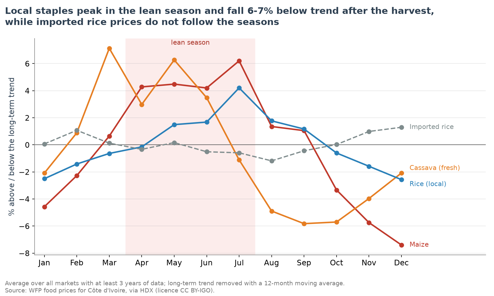

# Food prices in Côte d'Ivoire: what the data tells us

**For:** food security and market officers · **Data:** World Food Programme market prices, 2005-2026, 17 markets · **November 2026**

## In one sentence

Staple foods have become more expensive faster than general inflation, cost much more in Abidjan, rise every year before the harvest, and sudden price jumps can be spotted automatically each month.

## Four findings

**1. Staples are getting more expensive in real terms.**
Yam prices rose about **9% a year**, maize **5%**, cassava and rice about **4%**, above the 3% inflation ceiling set for the WAEMU countries. Over the period, maize prices rose by about **55%** and yam prices by about **84%**.

**2. Abidjan pays more for local food.**
Between 2011 and 2021, for the same product in the same month, fresh cassava cost about **77% more** in Abidjan than in the rest of the country, peanuts **45%**, palm oil **32%**, local rice **22%** and maize **18%**. Imported rice cost about the same everywhere, because it is distributed from Abidjan's port. The likely reason is the cost of transporting bulky, perishable food from the producing regions. The gap for local rice **keeps widening** (+5% in 2011, +43% in 2021).

**3. Prices follow the farming calendar.**
Maize is **4-6% above its normal level from April to July** (the lean season, when stocks run low) and about **7% below it in December**, after the harvest. Cassava peaks earlier (March-June) and is cheapest in August-October; local rice follows a smaller cycle (+4% in July). Imported rice does not follow this pattern.

**4. Price shocks can be detected automatically.**
A simple statistical alert flags a market when a price jumps far more than usual in one month (and by at least 10%). It found **330 shocks** since 2005, mostly for maize and cassava, with the most shocks in **2021-2022**, during the global rise in food prices.

## What we recommend

| Priority | Action |
|---|---|
| **Monthly alert** | Run the shock detection every month when WFP publishes new prices and send the list of markets in alert to the relevant teams. |
| **Before the lean season** | Plan support (stocks, cash transfers) for **March-April**, before maize and cassava prices peak, not after. |
| **Abidjan supply** | Look into transport and storage costs for cassava and other bulky local food between production areas and Abidjan. |
| **Better monitoring** | Abidjan is followed through a single market (Adjamé), with no data after 2021. Adding Abidjan markets would make the comparison more reliable. |

## Things to keep in mind

Prices are not adjusted for general inflation; markets covered change over time; some links with events are likely explanations, not proof.

*Source: World Food Programme, Côte d'Ivoire - Food Prices, via HDX (licence CC BY-IGO). Full method and code: project README.*
